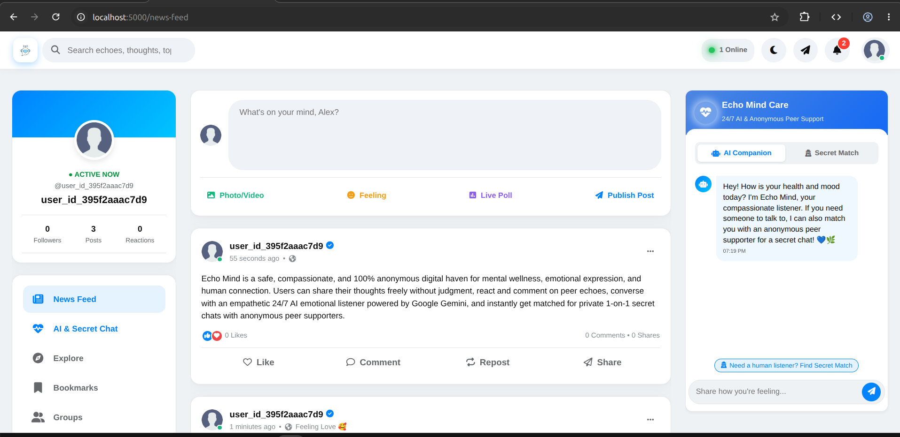
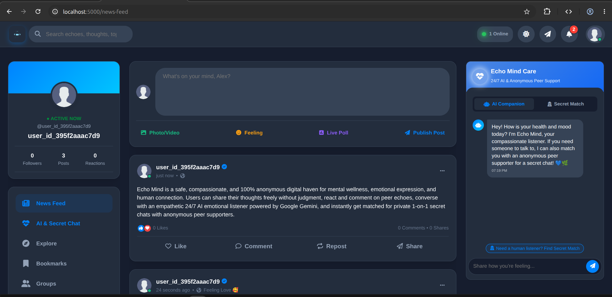
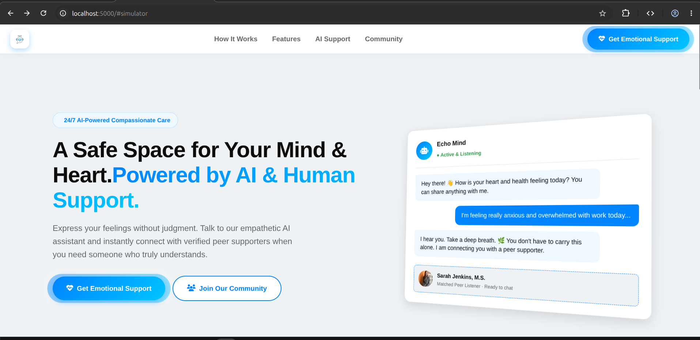
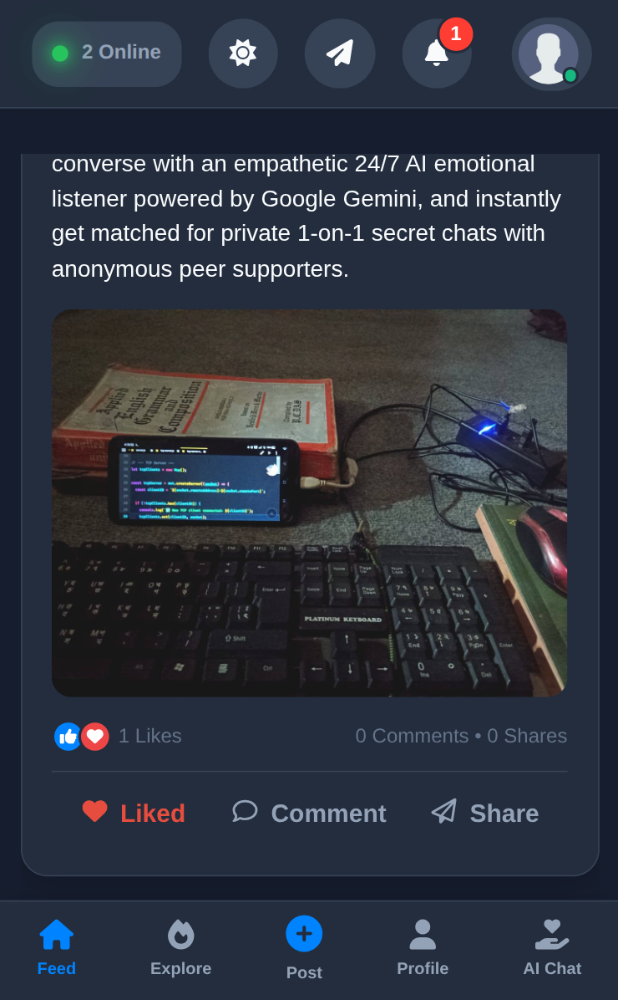
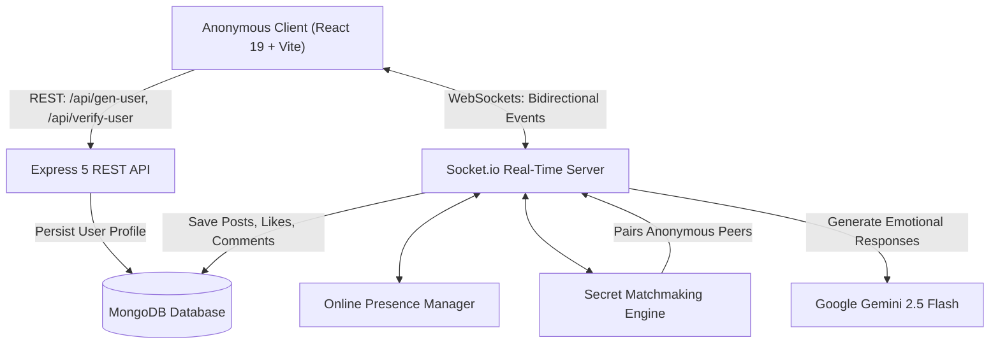

<p align="center">
  
</p>

# Echo Mind — Anonymous Emotional AI & Peer Support Platform

---


---

## Demo & Screenshots

 

 

---

## Live Deployments

- **Frontend App:** [https://echo-mind-app.onrender.com](https://echo-mind-app.onrender.com) (or [https://echo-mind-ghs.netlify.app](https://echo-mind-ghs.netlify.app))
- **Backend API & WebSockets:** [https://echo-mind-zd7k.onrender.com](https://echo-mind-zd7k.onrender.com)
- **Demo Video:** [Watch on Facebook](https://web.facebook.com/share/v/14pDbssh6i6/)

---

## Project Overview

**Echo Mind** is a safe, compassionate, and 100% anonymous digital haven for mental wellness, emotional expression, and human connection. Users can share their thoughts freely without judgment, react and comment on peer echoes, converse with an empathetic 24/7 AI emotional listener powered by **Google Gemini**, and instantly get matched for private 1-on-1 secret chats with anonymous peer supporters.

---

## Key Features

### 1. 100% Anonymous Social Feed

- **Zero Registration Barriers:** Automatic, cryptographically secure anonymous session generation with device tokens. No personal identifiable information required.
- **Expressive Echoes:** Post thoughts, mood/feeling tags (e.g., Anxious, Peaceful, Lonely, Hopeful), and media (images and video with chunked streaming uploads).
- **Infinite Feed:** Clean stream of community echoes with skeleton loaders and auto-pagination.

### 2. Real-Time Engagement & Live Reactions

- **Instant Like Synchronization:** Like or unlike echoes with animated blaze effects; updates broadcast live to all online users via WebSockets.
- **Interactive Comment Modal:** Live comments stream directly to post readers and authors in real-time.
- **Instant Feed Broadcasting:** New echoes published by any user appear in the feeds of active members instantly without page reloads.

### 3. 24/7 Emotional Support AI Companion

- **Powered by Google Gemini 2.5 Flash:** Provides warm, non-judgmental, compassionate validation and mindful coping strategies (such as 4-7-8 breathing and grounding exercises).
- **Context-Aware Dialogue:** Remembers recent conversation turns to offer relevant guidance.
- **Safety & Crisis Support:** Built-in detection for severe distress with instant helpline recommendations (988 Crisis Line).
- **Intelligent Fallbacks:** Seamless failover responses ensure support is always available even if network conditions fluctuate.

### 4. Secret Anonymous Matchmaking & 1-on-1 Chat

- **Intelligent Peer Matching:** Users seeking private human connection can request an anonymous match through the AI chat panel or the dedicated Secret Match tab.
- **Real-Time Matchmaker:** Pairs active online users into private encrypted rooms with generated anonymous aliases (e.g., `Echo Peer #A4F9`).
- **Live 1-on-1 Messaging:** Real-time secret chat with typing indicators, presence tracking, and graceful disconnect notifications.

### 5. Production-Ready Online Presence Management

- **Multi-Socket Presence Tracking:** Handles multiple tabs and device connections per user seamlessly without ghost sessions.
- **Real-Time Online Counter:** Broadcasts live active community counts across the navbar and sidebar.
- **Database Presence Sync:** Tracks online/offline states in MongoDB with clean disconnect handling.

---

## Architecture & Data Flow



---

## Tech Stack

### Frontend (`app/`)

- **React 19** & **TypeScript**
- **Vite 8** for fast development and optimized production bundling
- **Zustand 5** for reactive state management (`useAppStore`, `usePost`, `useAPI`)
- **Axios** with automatic token interceptors
- **Socket.io-Client 4.8** with auto-reconnection and credential support
- Custom CSS with responsive layouts, dark/light themes, and glassmorphism

### Backend (`backend/`)

- **Node.js** & **Express 5** (ES Modules, TypeScript)
- **Socket.io 4.8** with custom authentication middleware, heartbeat, and 100MB buffer
- **MongoDB** & **Mongoose 9** for document persistence
- **@google/genai 2.30** for emotional companion generation
- **geoip-lite** for anonymous regional presence
- **crypto** for secure token hashing and anonymous peer aliasing

---

## Project Structure

```plaintext
echo-mind/
├── app/                     # React 19 + TypeScript + Vite frontend
│   ├── public/              # Static assets, logos, and icons
│   ├── src/
│   │   ├── components/      # CreatePost, Post, CommentBox, Notification, Preloader
│   │   ├── layouts/         # MainApp, AIChat, AppHeader, AppSidebar, AppMobileBar, SocketListener
│   │   ├── libs/            # Axios API client configuration
│   │   ├── pages/           # HomePage, NewsFeed
│   │   ├── services/        # Socket.io client service
│   │   ├── store/           # Zustand state stores (useAppStore, usePost, useAPI)
│   │   ├── styles/          # Responsive CSS styles & themes
│   │   └── tools/           # Time formatting, feeling definitions, user parsing
│   ├── package.json
│   └── vite.config.ts
├── backend/                 # Express 5 + Node.js + TypeScript server
│   ├── src/
│   │   ├── config/          # App and MongoDB configuration
│   │   ├── controllers/     # User creation and verification controllers
│   │   ├── function/        # Post publishing, likes, comments, chunked uploads, notifications
│   │   ├── middlewares/     # CORS, Cookie auth, 404, and global error handlers
│   │   ├── models/          # User, Post, and Notification Mongoose schemas
│   │   ├── routes/          # Express API route declarations
│   │   ├── services/        # Google Gemini AI emotional companion service
│   │   ├── socket/          # Socket.io initialization, online manager, matchmaking engine
│   │   └── index.ts         # Server entry point with graceful shutdown
│   ├── package.json
│   └── tsconfig.json
└── README.md
```

---

## Environment Variables

### Backend Configuration (`backend/.env.development` / `backend/.env.production`)

```bash
# Environment Mode
NODE_ENV=development

# Server Port
PORT=3000

# Allowed CORS Origins (comma-separated or single)
CORS_ORIGIN=http://localhost:5000,http://localhost:5173

# MongoDB Connection String
MONGO_URI=mongodb://localhost:27017/echo-mind

# JSON Web Token Secret
JWT_SECRET=your_jwt_secret_key_here

# Google Gemini API Key
GEMINI_API_KEY=your_google_gemini_api_key_here
```

### Frontend Configuration (`app/.env`)

```bash
# Environment Mode
VITE_NODE_ENV=development

# Optional Custom Backend API URL (defaults to localhost:3000 in dev)
VITE_API_URL=http://localhost:3000
```

---

## Installation & Setup

### Prerequisites

- **Node.js 18.x or higher**
- **npm** (or pnpm / yarn)
- **MongoDB** running locally or a MongoDB Atlas connection string
- **Google Gemini API Key** (optional, graceful fallback provided)

### 1. Setup & Start Backend

```bash
cd backend

# Install dependencies
npm install

# Start in development mode with live watch
npm run dev

# Or build and run production server
npm run build
npm run start
```

Backend will start on `http://localhost:3000`.

### 2. Setup & Start Frontend

```bash
cd app

# Install dependencies
npm install

# Start Vite development server
npm run dev
```

Frontend will start on `http://localhost:5173` (or configured Vite port).

---

## Socket.io Event API Reference

| Event Name            | Direction       | Payload                         | Description                                               |
| :-------------------- | :-------------- | :------------------------------ | :-------------------------------------------------------- |
| `connection_ack`      | Server → Client | `User`                          | Acknowledges socket auth and returns verified user record |
| `online:stats`        | Server → Client | `{ onlineCount, timestamp }`    | Broadcasts current count of online users                  |
| `publish-post`        | Client → Server | `Post`                          | Publishes a new echo to the feed                          |
| `new-post`            | Server → Client | `Post`                          | Broadcasts newly published post to all connected users    |
| `fetch-post`          | Client → Server | `{ limit, skip }`               | Paginated retrieval of recent posts                       |
| `handle-like`         | Client → Server | `postID`                        | Toggles like/unlike on a post                             |
| `post-like-updated`   | Server → Client | `{ postID, likes }`             | Broadcasts updated like array to all clients              |
| `create-comment`      | Client → Server | `postID, Comment`               | Appends a comment to a post                               |
| `post-comment-added`  | Server → Client | `{ postID, comment, comments }` | Broadcasts new comment live to all clients                |
| `file-upload:chunk`   | Client → Server | `ChunkPayload, ack`             | Streams binary file chunks for media attachments          |
| `ai:message`          | Client → Server | `{ message, history }`          | Sends query to Echo Mind Emotional Support AI             |
| `ai:reply`            | Server → Client | `{ text, timestamp }`           | Returns AI empathetic listener reply                      |
| `secret:find-match`   | Client → Server | `{ feeling? }`                  | Queues user for secret anonymous peer matchmaking         |
| `secret:waiting`      | Server → Client | `{ message }`                   | Indicates user is actively searching for a match          |
| `secret:matched`      | Server → Client | `{ roomID, peer, message }`     | Connects two users to a private secret chat room          |
| `secret:send-message` | Client → Server | `{ roomID, text }`              | Sends a message inside the secret chat room               |
| `secret:new-message`  | Server → Client | `SecretMessage`                 | Broadcasts message to room members                        |
| `secret:typing`       | Client → Server | `{ roomID, isTyping }`          | Sends typing state to peer                                |
| `secret:peer-typing`  | Server → Client | `{ isTyping }`                  | Informs client of peer typing activity                    |
| `secret:leave-chat`   | Client → Server | —                               | Leaves current secret chat session                        |
| `secret:peer-left`    | Server → Client | `{ message }`                   | Informs peer that the other user left                     |
| `secret:cancel-match` | Client → Server | —                               | Cancels pending matchmaking queue                         |
| `all-notifications`   | Server → Client | `Notification[]`                | Delivers user notifications on connect or update          |
| `read-notification`   | Client → Server | `notiID`                        | Marks notification as read                                |
| `delete-notification` | Client → Server | `notiID`                        | Deletes notification                                      |

---

## Production Deployment Checklist

1. **MongoDB Atlas:** Configure database user, IP whitelist (`0.0.0.0/0` for cloud hosts), and paste URI into `MONGO_URI`.
2. **Backend (Render / Railway / VPS):**
   - Build Command: `npm install && npm run build`
   - Start Command: `npm run start`
   - Set environment variables (`NODE_ENV=production`, `PORT=3000`, `CORS_ORIGIN=https://your-frontend.netlify.app`, `MONGO_URI`, `JWT_SECRET`, `GEMINI_API_KEY`).
3. **Frontend (Netlify / Vercel):**
   - Build Command: `npm run build`
   - Publish Directory: `dist`
   - Set `VITE_API_URL=https://your-backend.onrender.com`.

---

## License

Distributed under the **MIT License**.

Designed and built with care for mental wellness and empathetic communication.

**Radhe Radhe**
